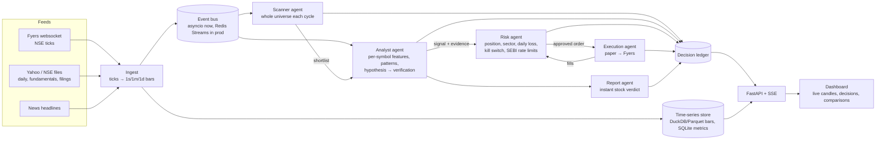

# Real-time Multi-Agent Trading System — Architecture

This document turns the product vision into an architecture: a continuous
market-data feed, several agents working at the same time (scan, analyse,
risk, execute, report), a decision ledger that makes every step explainable,
and a dashboard that shows it all live. Versions and tasks are in
[ROADMAP.md](ROADMAP.md) and [TASKS.md](TASKS.md).

## 1. The vision, stated precisely

| You asked for | What it is in this design |
|---|---|
| Data flowing to us the way it flows to the 100+ trading apps | A **broker websocket feed** (tick-by-tick NSE quotes) plus daily fundamentals and filings. §2 explains where the apps get it and what each option costs. |
| An agent that reviews stocks every second against history and patterns | The **Analyst agent**: on every new tick/bar it recomputes features, finds the most similar historical windows, forms a hypothesis ("breakout with volume; similar setups rose 68% of the time") and verifies it against the live outcome. |
| An agent that buys and sells as the analyst responds | The **Execution agent**: event-driven, paper mode first, then real orders through Fyers behind the existing safety gates and a **Risk agent** that can veto. |
| Every decision and comparison shown in real time when a stock is clicked | The **Decision ledger**: every signal, hypothesis, verification, order and veto is a record with its inputs and comparison charts; the stock page streams them live. |
| An instant "is this worth investing" report | The **Report agent**: rules plus LLM over our own metrics, financials, patterns and the ledger; under five seconds; every number linked to its source panel. |
| An agent that looks over all stocks and writes a line-wise profitability report | The **Scanner agent**: scores the whole universe every cycle and emits a ranked list with a one-line reason per stock. |
| ML models if needed | Yes, in stages (§6). Pattern similarity needs no training; a gradient-boosting model needs ~2 years of minute bars we must first collect; deep models only if those beat the baseline. |

## 2. Market data: how the apps get it, and our options

Trading apps do not scrape; they are brokers or they license exchange data.
NSE sells real-time data to brokers and vendors; brokers then stream it to
their own customers over a websocket, free or nearly free, for personal use.
That is the door open to us.

| Source | Market | Real-time? | Cost | Fit |
|---|---|---|---|---|
| **Fyers API v3** (websocket + history) | NSE/BSE equity, F&O | Yes, tick-by-tick, ~200 symbols per socket, 1-min history ~100 days per call | Free with a Fyers account | **Primary feed for v1.5.** Already integrated for daily data and orders. |
| Zerodha Kite Connect | NSE/BSE | Yes | ₹2,000/month (+₹2,000 historical) | Backup; best documentation |
| Upstox / Angel One SmartAPI / Dhan | NSE/BSE | Yes | Free with account | Backup feeds |
| Yahoo Finance | India + global | No (15-min delay), daily + fundamentals | Free | Research layer (v1.0); global coverage |
| Alpaca (IEX) / Polygon | US | Yes | Free (IEX) / paid | Global markets in v3.0 |
| NSE/BSE public files | India | Daily | Free | Filings, shareholding, deals, actions |

Rules that bind us: a broker feed is licensed for the account holder's own
use (no redistribution to other users without a vendor agreement), and SEBI's
2025 framework for retail algorithmic trading requires API orders to go
through the broker's static-IP whitelisting, with rate limits and
registration of strategies above the order-rate threshold. Both are
compatible with a personal system; a public multi-user product (v3.0) needs
a data-vendor agreement and broker approval, which are commercial steps, not
code.

**What only you can do:** open a Fyers account (free) and run the daily login.
Without it there is no real-time feed; everything else can be built against
recorded ticks.

## 3. Architecture



### 3.1 Agents

| Agent | Trigger | Does | Emits |
|---|---|---|---|
| **Ingest** | tick | Normalises ticks, builds 1-second/1-minute bars, maintains the live order book snapshot, writes to the store | `bar.1s`, `bar.1m`, `quote` |
| **Scanner** | every cycle (1 s on the watched set, 1 min on the full Nifty 500) | Recomputes the quick features (relative strength, volume surge, range position, momentum score), ranks the universe, writes a one-line reason per stock | `scan.ranked` (list of `{symbol, score, reason}`) |
| **Analyst** | new bar for a shortlisted symbol or an open position | Full feature set; nearest historical analogues (pattern similarity, §6.1); setup classification (breakout, pullback, mean-reversion, trend-continuation); hypothesis with expected move, probability from analogues/model, stop and target; later **verifies** each hypothesis against what happened and updates calibration | `signal` with `evidence` |
| **Risk** | every `signal`, every fill, every tick for open positions | Position size from account risk; sector and correlation caps; daily loss limit; max orders per minute; kill-switch file; market-hours and circuit checks; vetoes with a reason | `order.intent` or `veto` |
| **Execution** | `order.intent` | Paper fills from the live quote (with slippage model) or real Fyers orders (`LIMIT`/`SL-M`, order tags); tracks fills, partials, cancels; reconciles with broker positions | `order.placed`, `fill`, `reject` |
| **Report** | user click / `signal` | Assembles the verdict: scores, checklist, pattern analogues, current hypothesis, risk/reward, costs and tax, and a plain-language summary (Gemini via LiteLLM) with each sentence linked to its source | `report` |
| **Regime** (added) | daily + hourly | Market state: index vs averages, breadth, VIX, sector rotation; sets how aggressive the others may be | `regime` |

Every agent is a plain Python class with `handle(event) -> list[event]`, run
by one asyncio scheduler in development and by separate processes on a
Redis Streams bus in production. The same classes run in **replay mode**
over recorded ticks, which is how the whole system is backtested and how
tests run without a network.

### 3.2 Decision ledger (the explainability backbone)

Every event that changes a view or money is stored as a record:

```json
{
  "id": "2026-11-17T09:32:15.120Z-TATAMOTORS-ana-0412",
  "ts": "2026-11-17T09:32:15.120+05:30",
  "agent": "analyst",
  "symbol": "TATAMOTORS.NS",
  "kind": "hypothesis",
  "setup": "breakout",
  "horizon": "intraday",
  "inputs": {"price": 1012.4, "vwap": 1004.1, "rvol": 2.8, "range_pos": 0.97, "rsi14_5m": 66.2},
  "comparison": {
    "analogues": [{"date": "2025-03-04", "similarity": 0.93, "outcome_1h": 0.012}, "..."],
    "stats": {"n": 48, "win_rate": 0.67, "median_move": 0.009, "worst": -0.014}
  },
  "hypothesis": {"direction": "long", "expected_move": 0.009, "probability": 0.64, "stop": 1001.0, "target": 1024.0, "valid_for": "60m"},
  "verification": {"status": "pending"},
  "explanation": "Price cleared the 20-day high on 2.8× volume; in 48 similar setups the median one-hour move was +0.9%.",
  "chart": {"type": "candles+analogues", "window": "5m x 120"}
}
```

Later records reference earlier ones (`risk.veto → hypothesis id`, `fill →
order id`, `verification → hypothesis id`), so the stock page can draw the
whole chain as a timeline with the charts that were seen at each step.

### 3.3 Dashboard additions

- **Stock page, live:** candles (1 m / 5 m / 1 d), VWAP, the analyst's current
  hypothesis drawn on the chart (entry, stop, target), the analogue overlay
  (the historical windows the pattern matched, normalised and faded), the
  decision timeline streaming over SSE, the verdict card from the Report agent.
- **Scanner page:** the ranked universe refreshing each cycle, one line per
  stock, with sparklines and the reason; filters by setup and horizon.
- **Agents page:** each agent's heartbeat, queue depth, last decisions, error
  log; the Risk agent's limits and today's usage; the kill switch.
- **Portfolio, live:** positions with live P&L, open risk, the regime banner.

All of it in the existing design system (DESIGN.md): the glow follows the
pointer, numbers tick instead of flashing, nothing moves that is not data.

## 4. Horizons and honesty

"Every second" review is right for *watching*; it is not automatically right
for *trading*. The agents run at three horizons and the ledger decides, from
paper results after costs, which ones earn real money:

| Horizon | Bars | Costs per ₹1 lakh round trip (Fyers, intraday vs delivery) | What has to be true |
|---|---|---|---|
| Intraday (minutes–hours) | 1 s, 1 m, 5 m | ≈ ₹45 + 0.03% (STT 0.025% sell-side, brokerage ₹20/leg, GST, exchange) + slippage | Edge > 0.1% per trade after slippage; many trades; latency matters |
| Swing (days–weeks) | 1 d | ≈ 0.2% + 20% STCG on gains (already modelled) | The existing engine; modest, validated edge |
| Position (months) | 1 d / 1 w | Same, LTCG after a year | Quality/Value scores; the research platform |

No system guarantees profit, and this one will not claim to. What it will do
is make every decision measurable: hypotheses are verified, agents are scored
by after-cost results per horizon, and the Execution agent only goes live on
a horizon whose paper record has held up.

## 5. Latency and capacity budget (single machine)

- Feed: Fyers sends ~1–5 ticks/s per active symbol; 200 symbols ≈ 500–1000
  events/s; asyncio handles this comfortably.
- Scanner over Nifty 500 on 1-minute bars: < 200 ms with vectorised pandas.
- Analyst per symbol: feature recompute < 20 ms; analogue search over 2 years
  of minute windows with a prebuilt index (FAISS or scikit-learn ball tree) < 50 ms.
- Order path (signal → risk → broker): < 300 ms excluding broker latency.
- Storage: minute bars for 500 symbols × 2 years ≈ 95 M rows ≈ 2 GB Parquet; DuckDB queries in milliseconds.

## 6. Machine learning plan

### 6.1 Stage A — no training needed (v2.0)
- **Pattern similarity:** z-normalised price/volume windows (e.g. last 60
  one-minute bars), nearest neighbours by Euclidean/DTW distance over the
  history store; the outcome distribution of the neighbours is the
  "comparison with history". Transparent, fast, and already explainable.
- **Setup rules:** breakout, pullback-to-average, opening-range, mean
  reversion, defined with thresholds and shown on the chart.

### 6.2 Stage B — gradient boosting (v2.5)
- **Data needed:** ≥ 2 years of 1-minute bars for the universe (collected by
  v1.5 from Fyers history, 100 days per request, backfilled over a few
  nights) plus the daily data we have.
- **Features:** returns at several lags, range position, relative volume,
  VWAP distance, volatility, time of day, sector/regime state, analogue stats.
- **Targets:** direction and size of the move over 15 min / 1 h / 1 day, after costs.
- **Method:** LightGBM/XGBoost, walk-forward (train on months 1–12, test on 13; roll), probability calibration, feature importance kept in the ledger so the explanation stays honest.
- **Promotion rule:** a model replaces the rule baseline on a horizon only if out-of-sample after-cost profit factor and hit rate beat the baseline for three consecutive walk-forward folds.
- **Hardware:** a laptop CPU is enough (minutes per fold).

### 6.3 Stage C — sequence models (optional, v3.x)
- Temporal CNN / Transformer on bar sequences, only if Stage B shows a
  signal worth deepening. Needs a GPU for comfortable training; that is where
  the Higgsfield reference would apply, and only then.

## 7. Production shape (v3.0)

Docker Compose: `api` (FastAPI), `agents` (one process per agent group),
`ingest` (feed), `redis` (bus + cache), `timescale` or `duckdb` volume
(bars), `postgres` (ledger, users), `nginx` (TLS), `grafana`/`prometheus`
(agent heartbeats, latency, P&L), `alertmanager` → Telegram. Secrets from a
vault file, never in the image. Replay mode runs in CI against a recorded
day of ticks.

## 8. Additions I recommend (not in your list)

1. **Risk agent with a veto** — the loss-reduction half of "make profit".
2. **Decision ledger + replay mode** — without it nothing is explainable or testable.
3. **Regime agent** — the same breakout behaves differently in a falling market.
4. **Cost and tax model in every decision** (already built for delivery; add intraday).
5. **Monitoring and a kill switch on the Agents page** — production readiness is mostly this.
6. **Calibration tracking** — the Analyst's stated probabilities checked against outcomes, shown as a chart.
