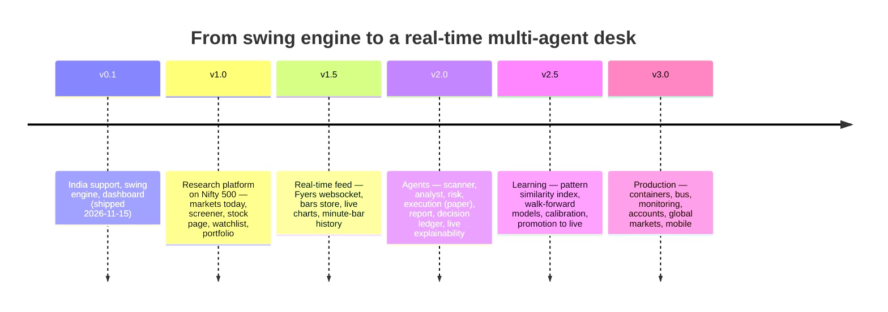

# Market Platform — Roadmap

Versions ship in order; each is usable on its own. Phases inside a version are
built in order because each depends on the one before. Task-level detail is
in [TASKS.md](TASKS.md); the agent architecture is in [AGENTS.md](AGENTS.md).

## v0.1 — Foundation (shipped 2026-11-15)

India market support in the analysis engine; the swing engine (Nifty 100
ranking, Indian-cost backtester, paper trading, gated Fyers live execution);
the animated dashboard and its redesign; daily routine; docs.

## v1.0 — Research platform core

Goal: a Trendlyne-shaped site on our own data for the Nifty 500. This is the
"click Tata Motors and see everything" layer that the agents later write into.

| Phase | Name | Delivers | Exit criteria |
|---|---|---|---|
| 1 | Data layer | `src/market/`: Nifty 500 universe, SQLite store, nightly refresh (prices, fundamentals, statements, actions, news, indices), metric catalogue, Quality/Value/Momentum scores, checklist, sector medians; `swing.py market refresh` | Refresh for 500 stocks ≤ 20 min; metric/score/checklist tests green; `market status` prints counts |
| 2 | API | `/api/market/*` (SPEC §6), screener grammar and presets, CSV export, user store | Contract tests green; p95 < 100 ms locally |
| 3 | Markets today | Home page: index strip, breadth, sector heatmap, movers, regime, upcoming, news | Renders from live DB at 1440 and 390 px; empty state when no refresh yet |
| 4 | Screener | Preset browser, filter builder, result table, URL state, CSV | Every preset < 1 s; filters survive reload; sort on every column |
| 5 | Stock page | All 12 sections of SPEC §1.3; price chart; peers | Opens for any Nifty 500 symbol; unknown symbol → clear empty state |
| 6 | Watchlist & portfolio | Named watchlists, holdings with valuation, allocation, vs Nifty | Survives restarts; add/remove from stock page and search |
| 7 | Shell | Router, navigation, ⌘K search, swing tabs under `/swing`, footer with sources | No dead links; keyboard path; reduced-motion verified |
| 8 | Release | `daily.sh` runs the refresh; docs; screenshot pass; tag `v1.0.0` | Fresh clone works from the docs alone |

## v1.5 — Real-time feed

Goal: live data flowing continuously, stored, and visible. Requires a Fyers
account (the only step that is yours).

| Phase | Name | Delivers | Exit criteria |
|---|---|---|---|
| 1 | Feed | `src/feed/`: Fyers websocket client with reconnect and token refresh, symbol subscription manager (watchlist + scanner shortlist + positions, ≤ 200 per socket), tick normaliser, recorder to Parquet (one file per day) | A full session recorded without gaps > 5 s; replay of the file reproduces the same bars |
| 2 | Bars & store | 1-second / 1-minute bar builder, VWAP, session stats; DuckDB over Parquet; minute-bar history backfill from Fyers (100 days per call, nightly loop until 2 years) | Bars match broker candles within 1 tick; backfill resumes after interruption |
| 3 | Live API | SSE endpoints (`/api/live/quotes`, `/api/live/bars/{symbol}`), server-side fan-out, last-value cache for reconnects | 50 concurrent browser tabs without lag on localhost |
| 4 | Live UI | Ticking prices on index strip, watchlist, stock header; live candle chart (1 m / 5 m) with VWAP and volume; market clock and session state | Numbers tick without flashing; reduced-motion path; 390 px works |
| 5 | Replay | Replay any recorded day at 1×/10×/max speed through the same pipeline | Used by tests and by the agent backtests in v2.0 |

## v2.0 — Agents

Goal: the five agents from AGENTS.md running at once, in paper mode, with
every decision explained live on the stock page.

| Phase | Name | Delivers | Exit criteria |
|---|---|---|---|
| 1 | Bus & ledger | Event schema, asyncio bus, decision-ledger store (SQLite → Postgres-ready), event replay | Every event persisted and queryable by symbol/time/agent |
| 2 | Scanner | Universe scan each cycle on live bars; ranked list with one-line reasons; Scanner page | Full Nifty 500 cycle < 1 s on 1-m bars; page refreshes live |
| 3 | Analyst | Feature engine on live bars; pattern-similarity search (Stage A); setup classifier; hypothesis records with stop/target/probability; verification job that scores past hypotheses; calibration chart | Hypotheses verified automatically; calibration tracked per setup |
| 4 | Risk & Execution | Risk agent (limits, vetoes, kill switch, SEBI rate limits); Execution agent in paper mode with a slippage model; reconciliation; Agents page | A recorded day replays into a paper P&L with every order traceable |
| 5 | Report | Instant verdict on any stock: scores, checklist, analogues, hypothesis, costs, LLM summary with sources | Under 5 s; every sentence links to a panel |
| 6 | Live explainability | Stock page: hypothesis drawn on the live chart, analogue overlay, decision timeline over SSE; portfolio live P&L | A click on a stock shows the chain scanner → analyst → risk → execution |
| 7 | Agent backtest | Run all agents over the recorded history (replay) with costs; per-agent, per-horizon, per-setup scorecards | Scorecards published in the dashboard; honest about negatives |

## v2.5 — Learning

| Phase | Name | Delivers | Exit criteria |
|---|---|---|---|
| 1 | Feature store | Point-in-time features from bars and daily data; leakage checks | Features reproducible for any past timestamp |
| 2 | Models | Walk-forward LightGBM per horizon; probability calibration; model registry; feature importance in the ledger | Three folds of out-of-sample results per horizon |
| 3 | Promotion | Rule baseline vs model on each horizon; promotion only on sustained out-of-sample improvement; shadow mode first | Decision documented in the ledger |
| 4 | Live, small capital | Execution agent switched to real Fyers orders on the horizon that earned it, with the v0.1 gates plus Risk agent limits; daily approval | Months of paper record first; approval file each day |

## v3.0 — Production

| Phase | Name | Delivers |
|---|---|---|
| 1 | Containers & bus | Docker Compose: api, ingest, agents, Redis Streams, DuckDB/Timescale, Postgres, nginx TLS; secrets outside images |
| 2 | Observability | Prometheus/Grafana: heartbeats, latency, queue depth, P&L; Alertmanager → Telegram; structured logs |
| 3 | Accounts | Login, per-user watchlists/portfolios/alerts; data-vendor and broker agreements for multi-user real-time |
| 4 | Global markets | US feed (Alpaca/Polygon), cross-market comparisons, currency handling |
| 5 | Mobile | Installable PWA, push alerts |
| 6 | Depth (from the research side) | NSE filings (shareholding, deals, SAST), statement pages, custom saved screens with alerts, compare tool, broker CSV import, F&O and mutual funds |

## Deliberately not planned

- Copying Trendlyne data, names or text.
- Claims of guaranteed profit; the ledger and scorecards say what is true.
- Paid data feeds or GPUs before the free pipeline and CPU models are exhausted.
